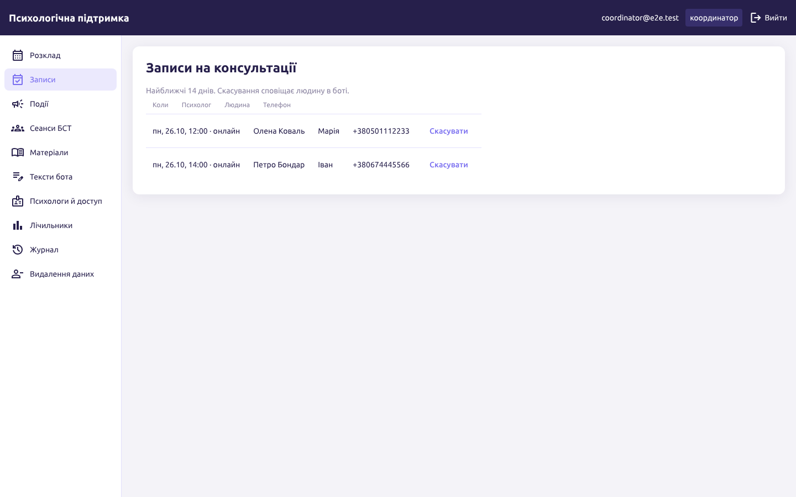
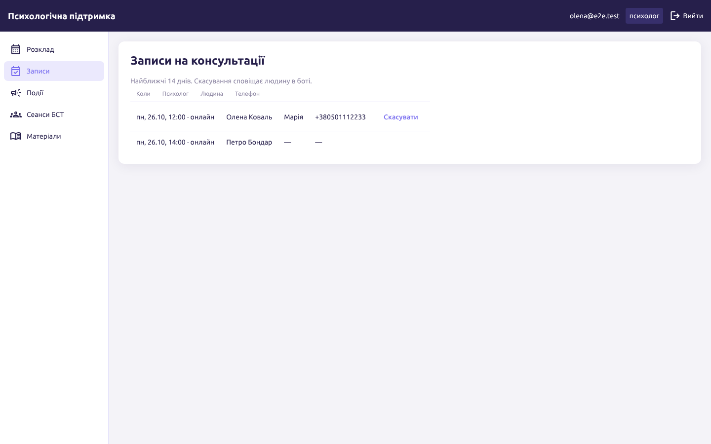

# psy-support — застосунок психологічної підтримки

Бекенд бота психологічної підтримки (перенесення з n8n) з власною БД, правилами й адмінкою. В OpenBP підключається як
MCP-конектор. Проєкт — `docs/psy-support.md`, задачі F3-33…F3-35, F3-31.

Один процес, три входи:

- `/mcp` — MCP (Streamable HTTP) для OpenBP і ШІ-агентів; той самий набір tools — через stdio;
- `/api/v1` — REST для сторінки адміністрування (cookie-сесія, ролі `coordinator` / `psychologist`);
- `/` — Angular-адмінка (F3-35) з `wwwroot`.

`psy-support` ніколи сам не пише в Telegram: tools бота повертають екран і `notifications`, а надсилає їх сценарій OpenBP
через `connectors/telegram`. Сповіщення від дій в адмінці потрапляють в `outbox` і забираються tool'ом `due_notifications`.

## Запуск

```bash
docker compose up -d postgres            # з кореня репозиторію; створіть базу psy_support і користувача
export ConnectionStrings__PsySupport="Host=localhost;Database=psy_support;Username=psy;Password=…"
export PSY_MCP_TOKEN=…                    # обов'язково для /mcp
export PSY_ADMIN_EMAIL=coordinator@…  PSY_ADMIN_PASSWORD=…   # перший координатор, якщо облікових записів немає
dotnet run --project src/OpenBP.Connectors.PsySupport -- --http http://0.0.0.0:8090
```

Адмінка відкривається на тій самій адресі (`/login`). Її треба зібрати один раз перед запуском:
`cd web && npm ci && npm run build` (результат — у `src/OpenBP.Connectors.PsySupport/wwwroot`, у git не потрапляє).

Міграції застосовуються під час старту. Без `--http` процес працює як stdio-MCP-сервер (так його запускає OpenBP).

| Змінна | Що |
|---|---|
| `ConnectionStrings__PsySupport` | рядок підключення до окремої бази `psy_support` |
| `PSY_MCP_TOKEN` | Bearer-токен `/mcp` для бота й агентів (без телефонів) |
| `PSY_MCP_TOKEN_PII` | Bearer-токен з доступом до телефонів; за замовчуванням не задано |
| `PSY_ADMIN_EMAIL`, `PSY_ADMIN_PASSWORD` | перший координатор |
| `PSY_TIMEZONE` | часовий пояс правил, типово `Europe/Kyiv` |

## Підключення до OpenBP

HTTP-сервер у реєстрі MCP OpenBP: URL `http://psy-support:8090/mcp`, credential
`{ "headers": { "Authorization": "Bearer <PSY_MCP_TOKEN>" } }`. Або stdio: команда `dotnet`, аргумент — шлях до
`OpenBP.Connectors.PsySupport.dll`, змінна `ConnectionStrings__PsySupport`.

## Tools

Бот (`docs/psy-support.md` §5.1): `bot_start`, `bot_menu`, `bot_materials`, `bot_consult`, `bot_events`, `bot_bst`,
`bot_cabinet`. Кожен повертає:

```json
{ "ok": true, "code": "booked",
  "screen": { "text": "…", "parse_mode": "HTML", "reply_markup": { "inline_keyboard": [[…]] }, "new_message": false },
  "notifications": [ { "chat_id": 123, "text": "Новий запис: 14.11, 09:00 — Марія" } ],
  "commands": null }
```

Доменні (§5.2): `register_user`, `get_user`, `list_psychologists`, `list_slots`, `book_slot`, `cancel_booking`,
`move_booking`, `list_bookings`, `list_events`, `register_event`, `cancel_event_registration`, `rate_event`,
`list_bst_sessions`, `book_bst`, `cancel_bst`, `join_waitlist`, `leave_waitlist`, `move_bst`, `list_materials`,
`get_material`, `due_notifications`, `mark_notifications_sent`, `generate_slots`, `anonymize_old_records`,
`send_event_notice`, `send_bst_notice`, `get_counters`.

Помилки домену (`slot_taken`, `too_late`, `limit_reached`, `full`, `not_psychologist`, `stale`…) — успішний результат з
`ok: false`; `isError` — лише некоректні аргументи або збій.

## Імпорт з Google Sheets

Вивантажте кожен лист таблиці в CSV (`settings.csv`, `users.csv`, `psychologists.csv`, `slots.csv`, `bookings.csv`,
`events.csv`, `registrations.csv`, `materials.csv`, `bst_sessions.csv`, `bst_bookings.csv`, `waitlist.csv`,
`counters.csv`) в одну папку й запустіть:

```bash
dotnet OpenBP.Connectors.PsySupport.dll import --dir ./sheets
```

Звіт (JSON, без персональних даних) показує, скільки рядків імпортовано, пропущено й чому. Повторний запуск нічого не
дублює. Зразок — `tests/OpenBP.Connectors.PsySupport.Tests/Import/sample`.

## Розробка

```bash
dotnet build -warnaserror && dotnet format --verify-no-changes && dotnet test   # тести піднімають postgres:16 у Testcontainers
ConnectionStrings__PsySupport=… dotnet ef migrations add <Назва> --project src/OpenBP.Connectors.PsySupport --output-dir Data/Migrations
```

### Адмінка (`web/`)

Angular (standalone, Signals) + Material + Tailwind, токени AC-Kit скопійовано з `apps/web`; тексти — через i18n-ключі.

```bash
cd web && npm ci
npm start                          # dev-сервер :4200, /api → бекенд на :8090 (proxy.conf.json)
npm run lint && npm test && npm run build
npm run e2e                        # Playwright проти справжнього бекенду (dotnet run --http :8095) і Postgres
```

`npm run e2e` створює окрему базу `psy_e2e_<випадково>` (рядок без бази — `PSY_E2E_POSTGRES`, типово локальний
`openbp/openbp`), координатора й токен `/mcp` генерує на кожен прогін. Записи людей створюються tools бота через `/mcp`.
Сценарії: вхід, обидві ролі, посилання-запрошення, психолог не бачить сторінок координатора й чужих телефонів (і REST
координатора відповідає йому 403). Скріншоти — у `test-results/screenshots`, приклади — у [`docs/screenshots`](docs/screenshots).

| Координатор: записи | Психолог: записи |
|---|---|
|  |  |
