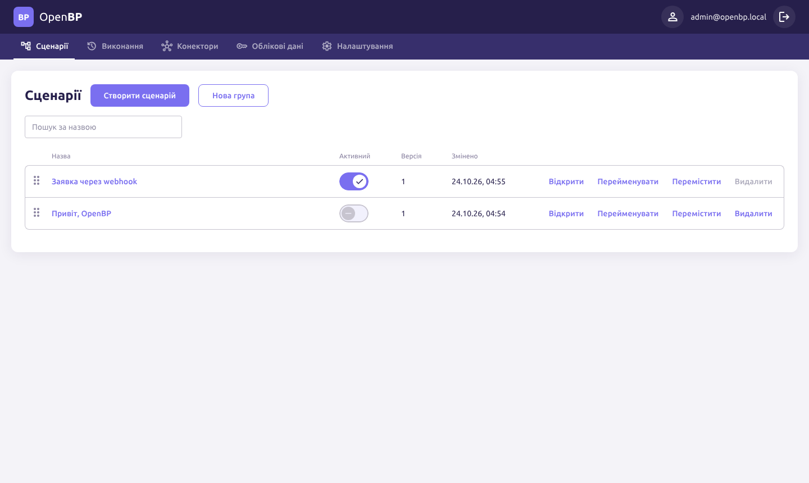
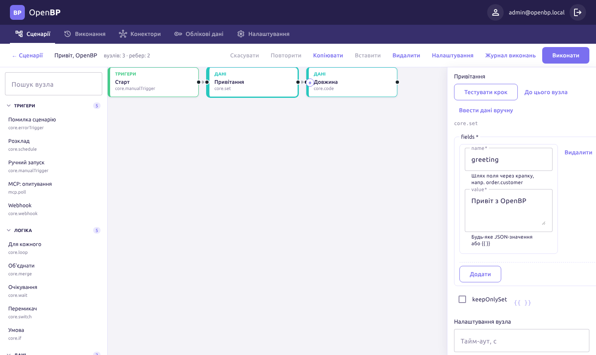
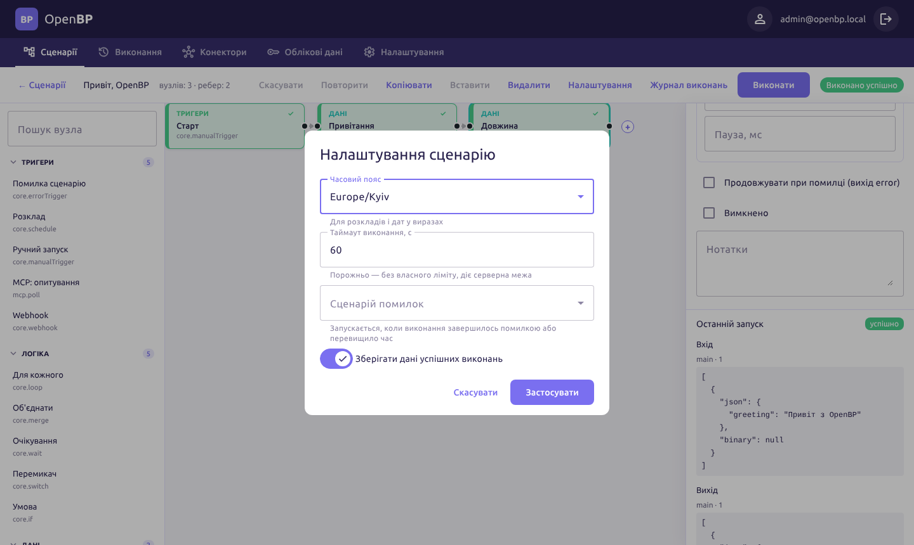
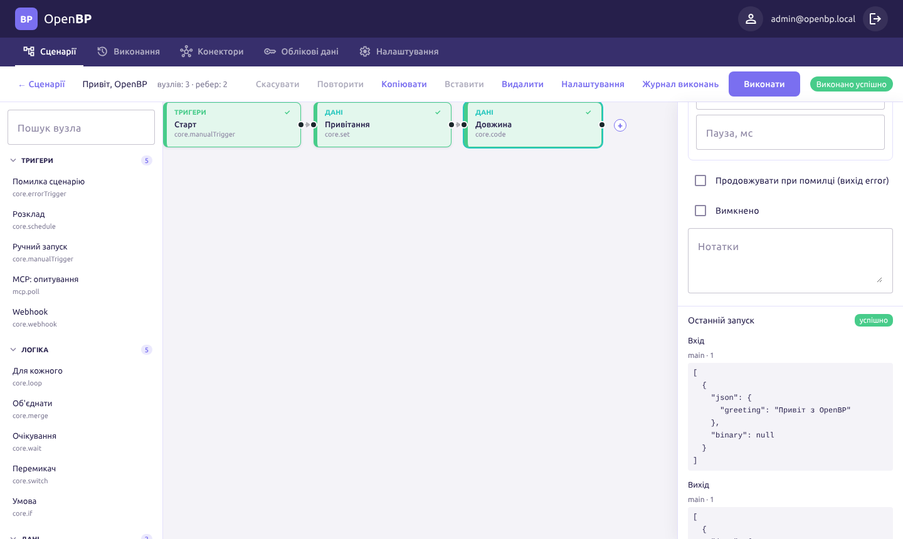
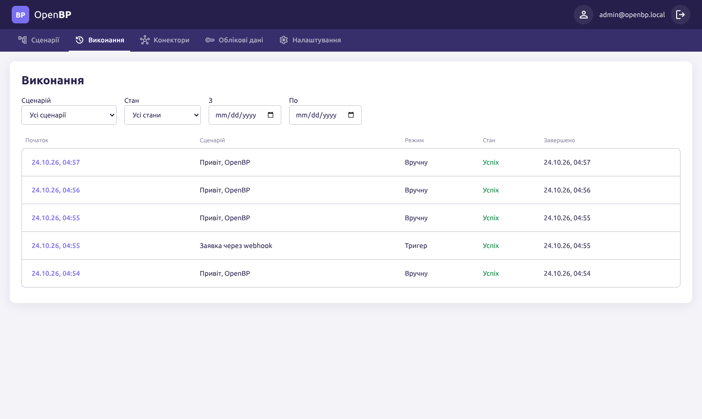
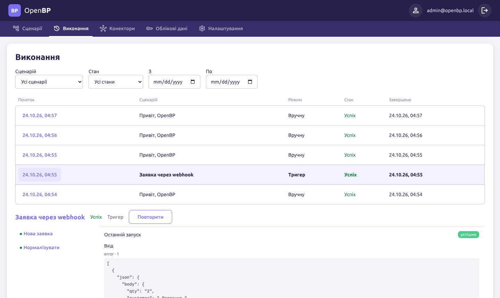
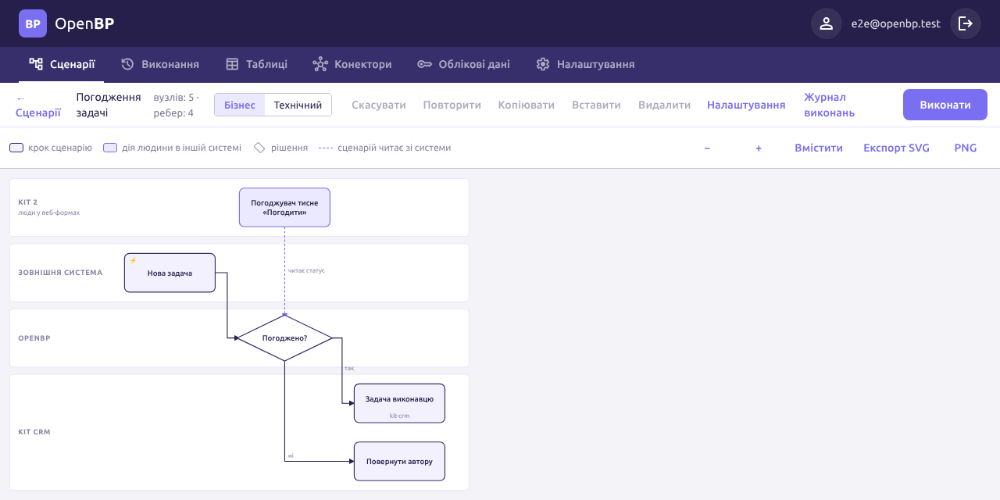

# Посібник автора сценаріїв

Для тих, хто збирає процеси на канвасі: від першого сценарію до виразів, коду, ШІ й обробки помилок. Потрібна роль
`editor` або `admin`. Конектори й облікові дані налаштовує адміністратор ([посібник адміністратора](../admin/README.md)).

## 1. Перший сценарій

«Сценарії» → «Створити сценарій». Відкриється редактор: ліворуч палітра вузлів з пошуком, посередині канвас, праворуч
панель виділеного вузла. Зміни зберігаються автоматично.



1. Перетягніть з палітри тригер «Ручний запуск» або натисніть `Tab` на порожньому канвасі: відкриється пошук лише по
   тригерах, `Enter` вставляє перший результат.
2. Виділіть вузол і натисніть «+» біля його виходу (або знову `Tab`): новий вузол з'явиться праворуч і одразу
   з'єднається. Те саме — якщо потягнути з'єднання з порту в порожнє місце. «+» посередині ребра вставляє крок між
   двома вузлами.
3. Додайте «Задати поля» (`core.set`): поле `greeting`, значення `Привіт з OpenBP`.
4. Додайте «Код (JavaScript)»: `return { ...$json, length: $json.greeting.length };`.
5. «Виконати». Вузли, що відпрацювали, позначаються галочкою, а в панелі вузла внизу — «Останній запуск»: вхід і
   вихід кожного кроку.



Скасувати/повторити — `Ctrl+Z`/`Ctrl+Shift+Z`, копіювати/вставити вузли — `Ctrl+C`/`Ctrl+V`, видалити — `Delete`.
Над вузлом при наведенні — тулбар: виконати, вимкнути/увімкнути, дублювати, перейменувати, видалити; ті самі дії (і
«Закріпити output», «Вставити») — у меню правою кнопкою миші на вузлі, ребрі чи порожньому місці. Клавіші поза полями
введення: `F2` — перейменувати (посилання `$node["…"]` у виразах оновлюються самі), `D` — вимкнути/увімкнути,
`Ctrl+D` — дублювати, `Ctrl+A` — виділити все, `Ctrl+Enter` — виконати сценарій, стрілки — перейти до сусіднього вузла.

Цей самий сценарій лежить у [`examples/hello-manual.json`](../../examples/hello-manual.json).

## 2. Як течуть дані

Кожен вузол отримує й віддає список **items**. Item — `{ "json": { … } }` (і, можливо, `binary` з посиланнями на
файли). Вузол виконується для кожного item'а: якщо тригер віддав 3 записи, наступний «Задати поля» відпрацює тричі.
Формат детально — [docs/workflow-format.md](../workflow-format.md).

Вузли «з коробки»:

| Група | Вузол | Що робить |
|---|---|---|
| Тригери | Ручний запуск | Запуск кнопкою «Виконати»; один порожній item. |
| | Webhook | HTTP-запит на `/webhook/<path>`; заголовки, query і тіло — перший item. |
| | Розклад | Cron (`0 7 * * 1-5` — о 7:00 у будні) у часовому поясі сценарію. |
| | MCP: опитування | Викликає tool конектора за розкладом і віддає лише нові записи (за `keyField`). |
| | Помилка сценарію | Старт сценарію помилок (див. [§6](#6-помилки)). |
| Логіка | Умова | Кожен item — на вихід `true` чи `false` за умовами. |
| | Перемикач | На вихід першого правила, що виконалось, інакше — `fallback`. |
| | Для кожного | Розгортає список з поля в окремі items. |
| | Об'єднати | Чекає обидва входи й об'єднує дані. |
| | Очікування | Пауза до 1 години. |
| Дані | Задати поля | Додає чи змінює поля; `keepOnlySet` — лишити тільки задані. |
| | Код (JavaScript) | Довільне перетворення ([§4](#4-код-javascript)). |
| ШІ | LLM | Запит до моделі ([§5](#5-ші-вузол-llm)). |
| Конектори | MCP: виклик tool'а | Дія в зовнішній системі через підключений MCP-сервер (1С, Telegram, Microsoft 365…). |

Активний сценарій (перемикач «Активний» у списку) слухає свої тригери: webhook, розклад, опитування. Ручний запуск
працює і без активації.

## 3. Вирази `{{ }}`

У будь-якому текстовому параметрі можна вставити JavaScript у подвійних фігурних дужках. Кнопка `{{ }}` біля поля
перемикає його в режим виразу.

| Змінна | Що це |
|---|---|
| `$json` | Дані поточного item'а. |
| `$node["Назва"].json` | Вихід іншого вузла (item з тим самим індексом або перший). При перейменуванні вузла вирази оновлюються самі. |
| `$binary` | Файли поточного item'а (лише опис, без вмісту). |
| `$input` | Усі items на вході вузла. |
| `$now` | Поточний час, рядок ISO 8601 в UTC. |
| `$execution.id` | Id виконання. |

Приклади (перевірені на [`examples/order-total.json`](../../examples/order-total.json)):

```text
{{ $json.customer.toUpperCase() }}                         → ПЕТРЕНКО
{{ $json.customer.toUpperCase() }}: {{ $json.total }} грн  → ПЕТРЕНКО: 1200 грн
{{ $node["Нова заявка"].json.body.message.chat.id }}       → 42
{{ Number($json.body.qty) }}                               → 2 (число, а не рядок)
```

Якщо все значення — один вираз, результат зберігає тип (число, масив, об'єкт). Якщо вираз змішано з текстом — це
рядок. Вираз має обмеження 50 мс, без доступу до мережі й файлів.

## 4. Код (JavaScript)

Вузол «Код (JavaScript)» — тіло функції, що повертає дані. Пісочниця: до 5 с, без мережі, файлів і `require`. `Date`
працює в часовому поясі сценарію.

- Режим `eachItem` (типово) — код виконується для кожного item'а; доступні `$json`, `$index`. Повертає об'єкт або
  масив об'єктів:

  ```js
  return { ...$json, total: $json.qty * $json.price };
  ```

- Режим `allItems` — один запуск на всі items; `items` — масив їхніх `json`. Повертає **масив** об'єктів:

  ```js
  const total = items.reduce((sum, line) => sum + line.total, 0);
  return [{ customer: $node["Замовлення"].json.customer, total, lines: items.length }];
  ```

`$node["Назва"].json` і `$node["Назва"].all` (усі items вузла) доступні для читання. Посилання на вузол, що ще не
виконувався, — помилка з його назвою.

### Таблиці даних

Довідники й стан між запусками (оброблені заявки, лічильники, черги) тримайте на сторінці «Таблиці»: створіть
таблицю з колонками (одна може бути ключем, наприклад `email`), а в сценарії додайте вузол «Таблиця даних».
Операція `upsert` (додати або оновити за ключем) не створює дублів навіть за одночасних запусків; `list` з умовами
`where` повертає по item на рядок. Таблицю можна заповнити з CSV або правити вручну. Деталі — у
[workflow-format.md](../workflow-format.md#таблиці-даних-coredatatable).

## 5. ШІ: вузол «LLM»

Параметри: провайдер (`anthropic`, `openai`, `openai-compatible` — Ollama, vLLM), модель, облікові дані з ключем,
`system`, `prompt` з виразами, `temperature`, `maxTokens`.

- Без `outputSchema` вузол повертає `{ text }`.
- З `outputSchema` (JSON Schema) модель зобов'язана відповісти структурою за схемою, і OpenBP перевіряє відповідь.
  Наступні вузли беруть поля напряму: `{{ $json.customer }}`.

```json
{
  "type": "object",
  "required": ["customer", "lines"],
  "properties": {
    "customer": { "type": "string" },
    "lines": { "type": "array", "items": { "type": "object",
      "properties": { "sku": { "type": "string" }, "qty": { "type": "number" } } } }
  }
}
```

Запит робиться для кожного item'а, таймаут — 60 с (змінюється в «Налаштуваннях вузла»). Приклад повного сценарію з LLM
і 1С — [`examples/telegram-1c.json`](../../examples/telegram-1c.json).

## 6. Помилки

Рівні захисту, від вузла до сценарію:

1. **Повтори** («Налаштування вузла» → «Повтори при помилці»): «Спроб усього» і «Пауза, мс». Корисно для мережевих
   збоїв зовнішніх систем.
2. **«Продовжувати при помилці (вихід error)»** — у вузла з'являється другий вихід `error`. Помилка не зупиняє
   сценарій: на `error` іде item `{ "error": { "message", "type", "attempts" } }`, і ви вирішуєте, що з ним робити.
3. **Тайм-аут вузла** (с) і **таймаут сценарію** («Налаштування» → «Таймаут виконання, с»). Перевищення — стан
   `timed_out`.
4. **Сценарій помилок.** Створіть окремий сценарій з тригером «Помилка сценарію», активуйте його і оберіть у
   «Налаштуваннях» робочого сценарію як «Сценарій помилок». Коли виконання завершиться помилкою або перевищить час,
   він отримає:

   ```json
   {
     "execution": { "id": "…", "status": "error", "mode": "manual" },
     "workflow": { "id": "…", "name": "Демо помилки" },
     "error": { "message": "Помилка в коді: немає клієнта", "nodeId": "n_check", "nodeName": "Перевірка" }
   }
   ```

   Наприклад, «Задати поля» з `«{{ $json.workflow.name }}» впав на кроці «{{ $json.error.nodeName }}»` і далі
   надіслати це в Telegram чи Teams через конектор.



У «Налаштуваннях» також: часовий пояс (розклади й `Date` у коді) і «Зберігати дані успішних виконань» — вимкніть для
сценаріїв, що часто працюють з великими даними: в історії лишаться статус і час.

## 7. Тестовий запуск і закріплені дані

- **«Виконати»** — весь сценарій вручну, від тригера. «Розклад» віддає item з поточним часом, «Помилка сценарію» —
  приклад помилки, а Webhook без закріплених даних виконатись не може: закріпіть йому приклад запиту (нижче).
- **«Тестувати крок»** (панель вузла) — виконати лише цей вузол на вхідних даних з останнього запуску.
- **«До цього вузла»** — сценарій від тригера до виділеного вузла, решта не виконується.
- **«Закріпити output»** — зберегти поточний вихід вузла (або вписати свій JSON) як закріплені дані. У ручних
  запусках вузол не виконується, а віддає закріплене. Так тестують гілки без справжнього webhook'а чи без виклику
  платного API. Закріплені дані діють лише в ручному запуску: активний сценарій завжди працює на живих даних.



## 8. Журнал виконань

«Виконання» — історія всіх запусків з фільтрами за сценарієм, станом і датами. Клік по рядку відкриває деталі: кроки,
вхід і вихід кожного вузла, текст помилки. «Повторити» запускає виконання знову з тими самими стартовими даними, тригер
вдруге не спрацьовує (для виконань без збережених даних повтор недоступний). «Журнал виконань» у редакторі відкриває
цю сторінку з фільтром за поточним сценарієм.





Стани: «У черзі», «Виконується», «Успіх», «Помилка», «Скасовано», «Перевищено час». Завершені виконання
автоматично видаляються через 30 днів (налаштовує адміністратор).

## 9. Сценарії через ШІ-агента

Сценарій можна не малювати, а описати Claude: OpenBP — MCP-сервер, агент бачить конектори, збирає сценарій, перевіряє і
запускає його з тими самими правами, що й ви. Як підключити — [посібник інтегратора](integrators.md#4-mcp-для-ші-агентів).

## 10. Бізнес-вигляд

Перемикач **«Бізнес | Технічний»** у заголовку редактора показує той самий сценарій як схему процесу для людей, яким не
потрібні вузли й параметри: власника процесу, керівника, користувачів CRM. Схема будується автоматично й не може
розійтися зі сценарієм ([концепція](../business-view.md)).

- **Доріжки** — хто виконує крок: назва конектора (`Кіт CRM`, `Telegram`), «OpenBP» для логіки сценарію,
  «Користувач» для ручного запуску, «Зовнішня система» для webhook'а, «ШІ» для LLM.
- **Кроки** — назви вузлів. Технічні вузли («Задати поля», «Код», «Об'єднати») і вимкнені вузли не показуються:
  стрілки через них з'єднують сусідні кроки напряму.
- **Рішення** — ромб з підписами гілок «так»/«ні», «варіант N», «інакше»; пунктирна помаранчева стрілка — гілка збою.
- Клік на крок відкриває його в технічному вигляді з панеллю вузла. Структуру сценарію в бізнес-вигляді не змінюють.
- **Виконання на схемі.** Під час тестового запуску й у «Журналі виконань» (перемикач «Бізнес») кроки зафарбовані
  за статусом: пройдено — зелений, виконується — виділена рамка, збій — червоний, не дійшло — блідий. Збій
  технічного вузла видно на найближчому кроці перед ним. Клік на крок у журналі показує його дані під схемою.
- **«Експорт SVG»** і **«PNG»** зберігають схему для документів і листів. Посилання з `?view=business` відкриває
  сценарій одразу в бізнес-вигляді.

Бізнес-назви кроків, власні доріжки (наприклад, «Кіт 2 · люди у веб-формах»), дії людей в інших системах і підписи
стрілок задаються бізнес-атрибутами сценарію (`docs/workflow-format.md`).


